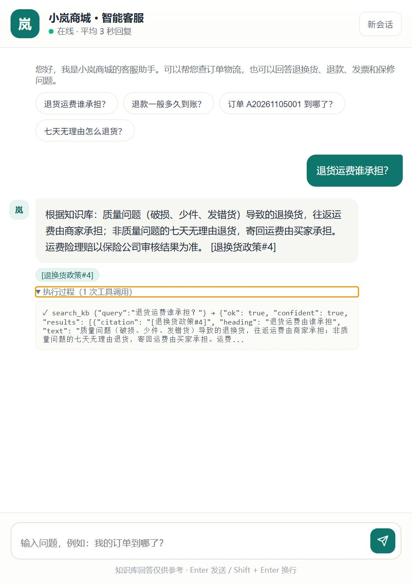

# 小岚商城 · 智能客服 Agent


一个**能跑、能测、结构清晰**的 LLM Agent 小项目：基于知识库 RAG 回答售后政策，通过工具调用查订单/物流、提交退款、转人工，并附带评测脚本和 29 个单元测试。代码量不大，但把「LLM 应用到底怎么落地」的关键环节都走了一遍。



---

## 1. 它解决了什么问题

电商客服每天要回答大量重复问题：发货时效、退货运费、退款到账、发票、保修……其中一部分还需要查具体订单。

如果只把知识库塞进 prompt：

- 上下文放不下，成本高，且容易答错；
- 无法查订单、算退款条件；
- 不知道“什么时候该说不知道”。

所以拆成三件事：

1. **RAG**：只把最相关的几段知识喂给模型，回答带引用；
2. **工具调用**：订单、物流、退款这类实时/写操作交给程序；
3. **Agent 循环**：让模型自己决定“查知识库”还是“查订单”，而不是写死 if-else。

## 2. 功能

- 知识库问答：7 篇售后文档，28 个切块，回答末尾标注 `[退换货政策#4]`
- 混合检索：向量余弦 + BM25（中文按字符 bigram），加权融合
- 5 个工具：`search_kb` / `get_order` / `get_logistics` / `request_refund` / `handoff_to_human`
- 多轮记忆：按轮次滑动窗口，正确保留 tool_call 与 tool 结果的配对
- 防护：检索置信度门槛、参数校验、退款二次确认、7 天期限校验、最大工具步数
- 两种模型接法：真实大模型（OpenAI 兼容）或无 key 的规则 mock
- 交付：FastAPI + 原生聊天页、CLI、pytest、评测脚本，零前端构建、零外部中间件

## 3. 架构

```text
浏览器 / CLI
    │  POST /api/chat
    ▼
FastAPI（app/server.py）
    ▼
CustomerServiceAgent（app/agent.py，自建 ReAct 循环）
    ├── LLM：DeepSeek / Qwen / GLM ……（OpenAI 兼容协议）
    └── ToolRegistry（app/tools.py，Pydantic 校验参数）
         ├── search_kb ──► Retriever ──► VectorStore（余弦）+ BM25
         ├── get_order / get_logistics ──► 模拟订单库（JSON）
         ├── request_refund ──► 期限/重复校验 + 用户确认 + 工单落盘
         └── handoff_to_human ──► 转人工工单
```

Agent 的核心就是一个循环，没有魔法：

```python
messages = [system] + history + [user]
for _ in range(max_steps):
    resp = llm(messages, tools)          # 模型决定：回答，还是调工具
    if not resp.tool_calls:
        return resp.content              # 不再调工具 -> 最终答案
    messages.append(assistant(resp.tool_calls))
    for call in resp.tool_calls:
        messages.append(tool(execute(call)))   # 结果回填，进入下一轮
return llm(messages, tools=None).content  # 步数用完，强制收尾
```

> 没用 LangChain，是因为这个循环本身只有几十行；手写之后每一轮消息长什么样、工具报错怎么回填、步数怎么限制都可控。逻辑上等价于 `create_tool_calling_agent + AgentExecutor`。

## 4. 快速开始

```bash
cd customer-service-agent

# 1. 安装依赖（建议虚拟环境）
python -m venv .venv
.venv\Scripts\activate            # macOS/Linux: source .venv/bin/activate
pip install -r requirements.txt

# 2. 配置模型（不配也能用 mock 跑通流程）
copy .env.example .env            # macOS/Linux: cp .env.example .env

# 3. 建索引 + 启动
python scripts/build_index.py
python run.py
# 打开 http://127.0.0.1:8000    （接口文档在 /docs）
```

`.env` 最少填一项：

```ini
LLM_API_KEY=sk-xxx
LLM_BASE_URL=https://api.deepseek.com
LLM_MODEL=deepseek-chat
```

通义千问把 `LLM_BASE_URL` 换成 `https://dashscope.aliyuncs.com/compatible-mode/v1`、模型换 `qwen-plus`；智谱同理。任何 OpenAI 兼容接口都能直接换。

没有 key 时会自动进入 **mock 模式**（`app/mock_llm.py`）：用几条规则模拟工具调用，只为把「页面 → 接口 → Agent → 工具 → 回答」跑通，不代表模型效果。

其他入口：

```bash
python cli.py                     # 终端聊天
python scripts/demo.py            # 一条固定对话，快速自检
python scripts/search_kb.py "退款多久到账"   # 单独调检索
python -m pytest                  # 29 个测试
python scripts/evaluate.py        # 跑评测集（无 key 自动用 mock）
```

## 5. 关键设计

### 5.1 切块与检索

- 先按 Markdown 的 `##` 章节切，再按 220 字、40 字重叠二次切分；切块向量化时把「文档标题 / 章节标题」拼进去，避免“7 天”这种片段脱离上下文。
- 检索分数：

```text
score = 0.65 * cosine + 0.35 * (bm25 / max_bm25)
```

  只用向量时，订单号、型号这类专有名词容易飘；只用 BM25 时，“怎么退”和“退款流程”这种不同说法召回不到。混合检索是最便宜的折中。
- 置信度不只看分数：`cosine ≥ 0.15` **或** `bm25 ≥ 2.5 且 cosine ≥ 0.08`。短问句（“怎么开发票”）只和文档共享两个词，单纯卡余弦阈值会误判成“不知道”。
- 默认 `HashingEmbedder` 用字符 bigram 做带符号哈希，零依赖、离线可测；它**不是语义模型**，换 `EMBEDDING_MODE=openai` + bge-m3 后才是真正的语义向量。这是默认配置的取舍。

### 5.2 防幻觉与防越权

| 风险 | 措施 |
| --- | --- |
| 知识库没有答案还硬编 | `confident=false` 时工具直接返回空结果，提示转人工 |
| 答案没有依据 | 系统提示要求带 `[标题#编号]`，前端展示引用 |
| 模型传错参数 | 每个工具用 Pydantic 模型校验，错误结构化回填给模型 |
| 模型擅自退款 | 程序检查**当前用户消息**是否包含明确确认词，否则只返回 `need_confirmation` |
| 重复/超期退款 | 订单状态 + 签收 7 天期限双重校验 |
| 工具死循环 | `MAX_STEPS=5`，之后不再提供工具，强制收尾 |
| 隐私 | 订单查询返回手机号脱敏结果 |

### 5.3 评测

`eval/cases.jsonl` 有 12 条用例，覆盖知识库问答、订单、物流、退款边界、转人工、无关问题。指标刻意做得朴素、可解释：

- **工具召回率**：该调的工具有没有调（期望工具是否都出现在实际调用里）
- **关键词命中**：答案是否覆盖关键事实（如“工作日”“运输中”）
- **转人工准确率**：该转人工时是否转了
- **平均耗时**：为后续性能优化留基线

当前 mock 模式结果（仅验证评测链路，不代表真实模型能力）：

```text
pass_rate  1.0
tool_recall 1.0
keyword_accuracy 1.0
handoff_accuracy 1.0
```

换成真实模型后数字会波动，报告写入 `eval/report.json`。局限也很明确：关键词匹配不能判断“答得对不对”，下一步可以加 LLM-as-judge / RAGAS，或人工标注 50 条做金标准。

### 5.4 测试

29 个 pytest，全部不依赖外网：

- 切块长度、重叠、编号唯一
- 向量库排序、落盘/加载、维度校验
- 检索：政策问题命中正确文档、无关问题不置信
- 工具：脱敏、未知订单、退款确认、超期、重复退款、非法参数、未知工具
- Agent：工具调用→回填→回答、引用收集、转人工标记、步数上限、记忆裁剪
- 全部用 `FakeLLM` 脚本化响应，稳定、快（<1s）

GitHub Actions 会在每次 push / PR 时用 Python 3.10 和 3.12 跑一遍测试、建索引和 mock 评测，见 `.github/workflows/ci.yml`。所有测试不依赖外网和 API Key。

## 6. 目录结构

```text
customer-service-agent/
├─ app/
│  ├─ agent.py          ReAct 循环（核心）
│  ├─ llm.py            LLM 协议 + OpenAI 兼容实现
│  ├─ tools.py          工具定义、参数校验、退款规则
│  ├─ memory.py         会话记忆与安全裁剪
│  ├─ prompts.py        系统提示词
│  ├─ mock_llm.py       无 key 时的规则兜底
│  ├─ server.py         FastAPI 接口
│  ├─ static/index.html 聊天页面（原生 HTML/JS，无构建）
│  └─ rag/
│     ├─ loader.py      Markdown 解析
│     ├─ chunker.py     切块
│     ├─ embedder.py    hashing / OpenAI embedding
│     ├─ store.py       向量库
│     ├─ bm25.py        BM25
│     └─ retriever.py   混合召回 + 置信度
├─ data/
│  ├─ kb/*.md           售后知识库
│  └─ orders.json       模拟订单（日期按“今天”倒推）
├─ eval/cases.jsonl     评测用例
├─ scripts/             build_index / search_kb / demo / evaluate
├─ tests/               29 个单元测试
├─ cli.py / run.py
└─ docs/screenshot.jpg   界面截图
```

## 7. 已知局限与下一步

- **语义检索**：默认 hashing embedder 只是词面近似；接 bge-m3 后才是语义向量，可再加重排序（bge-reranker）。
- **会话存储**：目前进程内字典，重启丢失、不能多实例；生产换 Redis，并按 session 加 TTL。
- **订单/退款**：JSON + jsonl 模拟；真实场景换数据库，并加幂等键、事务和审计日志。
- **评测太粗**：关键词不等于正确；补充 LLM-as-judge、检索命中率（Recall@K）和人工标注。
- **成本与延迟**：可加流式输出、结果缓存、并发限流、token 统计。
- **可观测性**：加 trace（每次工具调用、耗时、token），方便定位“哪一步答错了”。
- **MCP**：把工具层换成 MCP server，就能被多个 Agent 复用，也便于对接其他客户端。

## 8. License

[MIT](LICENSE)
